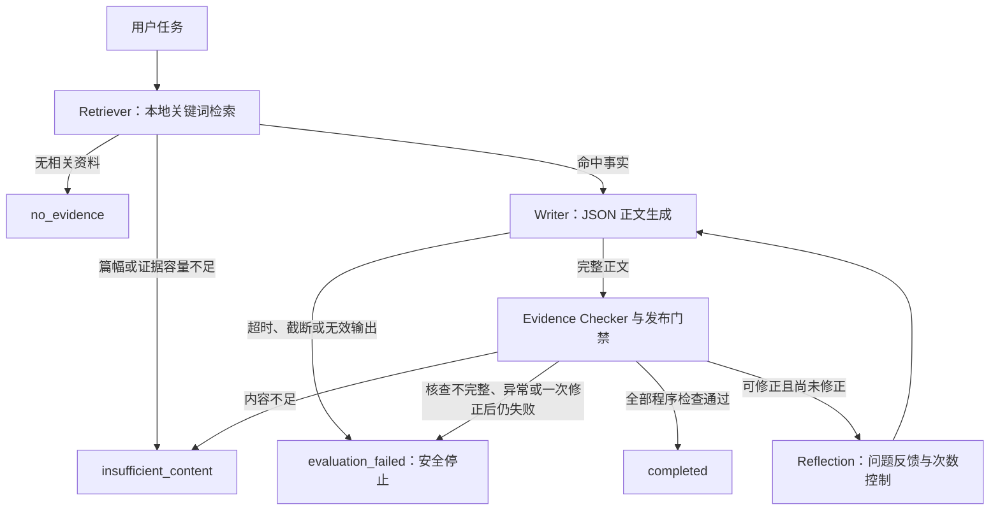

# health-agent-lab

基于 **FastAPI、LangGraph 与本地 Ollama** 的健康科普 Agent 工程展示项目。项目关注从检索、生成到发布的流程可靠性，以及 Reflection 自动修正带来的收益和成本。

当前知识库只包含少量睡眠与身体活动摘要，适合演示有边界的检索与证据检查。它不是诊疗系统，生成内容的医学正确性尚未经过独立专家审核。

## 主要功能

- 从本地知识库检索与任务关键词相关的资料，把事实与来源提供给 Writer。
- 通过 `json_article_v1` 协议生成 `{"article": "正文"}`，拒绝截断、未正常结束或解析失败的输出。
- 区分医学事实、证据不足声明与文章元描述，检查事实支持、引用及数字/范围/单位一致性。
- 独立核对被复述的用户任务参数；允许省略假设数字，拒绝把“20分钟”写成“2.0分钟”。任务里的假设不会成为医学证据。
- 对可修正的问题最多进行一次 Reflection → Writer 重写，并完整重新核查；仍失败则停止发布。
- 提供 FastAPI 接口、禁网自动化测试和 Reflection OFF/ON 配对评测入口。

## 工作流程与职责



| 组件 | 职责 |
|---|---|
| Retriever / RAG | 按任务关键词命中 `data/health_knowledge.json` 条目，加载事实及来源。当前实现使用本地关键词检索。 |
| Writer | 只依据给定事实生成短正文；模型输出必须正常结束、满足 JSON 协议和长度约束。 |
| Evidence Checker | 分类完整语句的作用范围，对实质医学主张执行四分类 Verifier，并检查引用、内容覆盖及医学数值。超出覆盖上限会阻止发布。 |
| 任务参数保真 | 在最终候选回答发布前，独立比较原任务与被复述的数值、范围、单位及上下界；证据不足声明也要检查。 |
| Reflection | 组织问题反馈、增加修正次数；实际重写由 Writer 执行，最多一次，重写后再次经过全部门禁。 |
| 安全停止 | 无证据时不生成；生成失败、核查异常或修正后仍有问题时，不对外发布失败草稿。 |

Verifier 的四分类为 `supported`、`not_supported`、`contradicted`、`uncertain`，依据仅限提供的本地事实。规则检查与模型核查都可能存在语义边界，`completed` 只表示当前程序发布门禁通过。

## 项目结构

```text
app/
  api.py                     # FastAPI 请求与错误处理
  agent.py                   # LangGraph 生产节点与路由
  knowledge.py               # 按源码位置加载知识库
  writer.py                  # JSON 协议、生成预算与结束状态检查
  claim_verifier.py           # 医学主张四分类
  evidence_checker.py         # 证据核查与最终发布门禁
  evidence_quantities.py      # 医学事实数字/范围/单位检查
  task_parameters.py          # 用户任务参数复述保真
  content_requirements.py     # 内容覆盖与证据容量检查
data/health_knowledge.json     # 当前生产知识库
tests/                        # 离线 Agent、接口与安全回归
evaluations/
  reflection_ab/              # 当前四场景、八次独立 A/B 评测入口
  tests/                      # 离线评测流程与指标回归
  fixtures/                   # 脱敏、最小化的离线历史测试输入
  claims*.json                # Claim Verifier 评测数据
  frozen/                     # 既有实验冻结信息
legacy/pre_modularization/     # 早期核心实现的只读历史源码
docs/
  INSTALL.md                  # Mac 安装、配置与启动说明
  reports/                    # 适合公开的脱敏实验摘要
requirements*.txt             # 运行、开发依赖及版本约束
.python-version               # 验证过的 Python 版本
.env.example                  # 无凭据的本地配置示例
api.py                        # 兼容 api:app 导入方式
health_content_agent_v3.py     # 兼容旧命令行入口
claim_verifier.py              # 兼容旧导入/命令行入口
evaluate_claims.py             # 显式 Claim Verifier 评测入口
```

知识库路径由源码位置确定，包内部使用相对导入。当前实现统一读取 `data/health_knowledge.json`；根目录同名文件及早期 demo 仅用于历史兼容，不能替代当前知识库。大量原始实验日志、个人环境与缓存留在本地，不随公开仓库发布；公开摘要与离线测试输入单独保留。

## Mac 安装与运行

详细说明见 [docs/INSTALL.md](docs/INSTALL.md)。已验证的 Python 版本为 **3.12.10**，安装命令使用 `python3.12`。把下面仓库地址中的 `YOUR_GITHUB_USERNAME` 替换为实际发布者账号。

```sh
git clone "https://github.com/YOUR_GITHUB_USERNAME/health-agent-lab.git"
cd health-agent-lab

python3.12 -m venv .venv
source .venv/bin/activate
python -m pip install -r requirements-dev.txt
python -m pip check
```

`requirements.txt` 定义运行依赖，`requirements-dev.txt` 同时安装运行依赖和测试工具，`requirements-lock.txt` 约束本轮验证的依赖版本。仅安装依赖、导入应用、访问 `/health` 或运行离线测试不需要启动 Ollama，也不会调用真实模型。

实际生成需要本机安装 Ollama 并准备 `qwen3:4b`。下面是使用者自行执行的模型准备步骤；模型下载不包含在仓库中。

```sh
# 终端 1：已有 Ollama 桌面服务运行时，不必重复启动
ollama serve
```

```sh
# 终端 2：首次使用需要下载；已安装时用 list 检查
ollama pull qwen3:4b
ollama list
```

在已激活虚拟环境的项目根目录启动 API：

```sh
export OLLAMA_HOST=http://127.0.0.1:11434
unset INJECT_BAD_FACT INJECT_FALSE_CLAIM
python -m uvicorn app.api:app --host 127.0.0.1 --port 8000
```

浏览器打开 `http://127.0.0.1:8000/docs` 查看 OpenAPI 文档。兼容入口 `python -m uvicorn api:app --host 127.0.0.1 --port 8000` 也可使用。

`.env.example` 提供配置示例，当前应用不会自动加载 `.env`。需要环境变量时请明确导出，或按安装说明加载可信的本地配置。故障注入标志只用于受控测试，普通运行应保持未设置或为 `0`。生产客户端读取 `OLLAMA_HOST`；已冻结的真实 A/B 入口要求本机 `127.0.0.1:11434` 与本机模型 manifest，详见评测说明。

Writer 当前固定 `qwen3:4b`、`temperature=0`、`seed=42`、`num_predict=512`、`num_ctx=4096`，单次请求超时45秒，正文上限600字符。Verifier 参数从生产代码读取。固定种子不保证不同模型文件、Ollama版本或机器上输出逐字一致；更改配置后应作为新实验版本记录。

## FastAPI 使用示例

健康检查：

```sh
curl -sS http://127.0.0.1:8000/health
```

```json
{"status":"ok","service":"HealthAgent API"}
```

生成接口接收5至500字符的 `task`。下面示例命中当前知识库的无证据分支，会安全停止且不调用模型：

```sh
curl -sS http://127.0.0.1:8000/generate \
  -H 'Content-Type: application/json' \
  -d '{"task":"请写一篇科学补钙的科普文章。"}'
```

```json
{
  "status": "no_evidence",
  "answer": "知识库中没有找到相关资料，暂不生成内容。",
  "evidence_count": 0,
  "revision_count": 0,
  "duration_seconds": 0.01
}
```

耗时为示意值。与睡眠、身体活动资料相关的生成请求会调用真实本地模型。Agent正常返回时保留 `status`、`answer`、`evidence_count`、`revision_count`、`duration_seconds` 五个字段；参数或执行异常使用后述HTTP错误格式。

| 最终状态 | 含义 |
|---|---|
| `completed` | 当前程序发布门禁通过，返回正文。 |
| `no_evidence` | 未检索到相关本地资料，不生成正文。 |
| `insufficient_content` | 资料覆盖或篇幅容量不足以满足任务。 |
| `evaluation_failed` | 生成或核查失败，或一次修正后仍有问题，返回安全停止说明。 |

请求参数不符合约束时返回 HTTP 422；未预期执行异常返回 HTTP 503 和通用错误说明，不向接口调用方暴露内部异常细节。`/health` 仅确认 API 可响应，不证明 Ollama 或模型已可用。

## 离线自动化测试

从项目根目录运行完整测试集：

```sh
python -m pytest -q tests evaluations/tests
```

这些测试阻断网络，使用 Mock 或已保存的离线夹具，不要求 Ollama 运行。FastAPI TestClient 测试包含健康检查、参数校验、响应兼容和失败处理；Agent回归覆盖截断、证据不足作用域、医学数字、任务参数保真、Reflection上限与终态。最终 A/B 冻结版本的基线为 **457 项通过**。工程交付整理新增两项公开校验范围回归，当前完整套件为 **459 项通过**；原实验指标与测试冻结记录没有改写。后续修改应重新执行同一完整命令。

仅检查导入或接口测试时可运行：

```sh
python -c "from app.api import app; print(app.title)"
python -m pytest -q tests/test_api.py
python -m evaluations.reflection_ab.run --validate-only
```

`--validate-only` 不访问网络、不调用模型，仅校验固定场景与生产配置。直接导入应用和评测模块也不会自动开始实验。

## 最终 Reflection OFF / ON 实验

公开结果见 [最终报告](docs/reports/final_reflection_ab.md)、[逐任务对照](docs/reports/final_reflection_ab_cases.csv) 和 [配置版本](docs/reports/final_reflection_ab_config.json)。原始实验目录保持不变，公开摘要不包含开发者个人路径、完整环境快照或大量增量日志。

四个固定场景分别独立执行OFF/ON，共8次端到端评测图运行。两组复用同一生产节点、实际路由、模型、Prompt、知识库、JSON协议和发布门禁，唯一策略区别是OFF禁止自动重写、ON最多重写一次。评测图的ON路径已用离线同稿验证与公共生产入口一致。

| 指标 | OFF | ON |
|---|---:|---:|
| 完成且通过程序发布门禁 | 0/4 | 2/4 |
| 计入 R-NONE 正确停止的程序目标达成 | 1/4 | 3/4 |
| 安全停止 | 4/4 | 2/4 |
| 可观测门禁违规发布 | 0 | 0 |
| Reflection 修正成功 | 不适用 | 2/3 |
| 模型调用 | 7 | 12 |
| 任务累计耗时 | 21.20秒 | 30.59秒 |
| 任务 P50 / P95 | 6.69 / 7.74秒 | 9.16 / 12.23秒 |

ON修复了正常睡眠任务和错误主张注入任务；证据不足任务仍在修正后将20分钟写成2.0分钟，任务参数门禁阻止了发布。无证据场景两组均为0次模型调用。ON多用5次调用和约9.39秒任务耗时（+44.3%）。

每组仅4项，含零模型任务；P50/P95按线性插值计算，仅作样本描述。OFF首个Writer包含约2.075秒模型加载，缓存、运行顺序与系统负载都会影响耗时。程序完成率、预期安全停止、可观测门禁违规和独立医学审核是不同指标；本轮没有独立医学审核，不能把0次门禁违规解读为0个医学错误，也不能据此推断总体成功率。

普通安装和测试不会自动重跑实验。如需开展新的一轮真实评测，先阅读 [评测说明](evaluations/reflection_ab/README.md)，确认本地模型和预算后自行执行；每次都会生成新的结果目录：

```sh
mkdir -p test-results
python -m pytest -q tests evaluations/tests --junitxml=test-results/offline.xml
python -m evaluations.reflection_ab.run --run-small --pytest-junit test-results/offline.xml
```

该命令会调用真实模型，固定8次独立任务，无自动重试。历史共享前缀、不同生成预算的实验与本轮设计不同，不能混池计分。

## 已知问题与展示边界

- **模型数字失真仍存在。** Writer曾把60岁写成6:0岁、把20分钟写成2.0分钟；当前门禁阻止这些已覆盖的错误发布，没有根除模型生成问题。
- **一次Reflection不保证修复成功。** 重写可能保留或引入新错误，必须重新完整核查，达到上限后停止。
- **知识库覆盖有限。** 检索是本地关键词匹配，事实摘要少；无资料或不满足长篇要求时会停止，不能自行扩写外部医学结论。
- **程序规则有语义边界。** 数字和任务参数检查主要覆盖显式可解析数量及局部概念/指代；“减半”等隐含数量和自由语义仍需人工判断。
- **医学质量未经独立专家审核。** Verifier也可能误判；程序检查、自动化测试与AI建议标签均不能冒充独立人工审核。
- **实验样本很小。** 当前结果适用于四个受控场景，不支持普遍疗效、医学准确率或广泛性能优势的结论。

本仓库用于展示 Agent 工程拆分、受控评测、失败记录和安全发布流程。准备公开时应保留公开报告与必要测试输入，检查Git待提交清单，并将凭据、私人路径、虚拟环境及大量原始实验数据留在本地。


## GitHub 发布准备

查看 [发布步骤与待提交范围](docs/PUBLISHING.md)。原始实验、旧demo及历史版本保留在本地或原Git历史中，不擅自删除；公开仓库包含必要代码、脱敏报告与可离线运行的最小夹具。维护者需替换仓库URL占位符、确认作者身份与许可方式，再自行审阅、提交和推送。本轮没有自动执行Git写入或远程发布。
